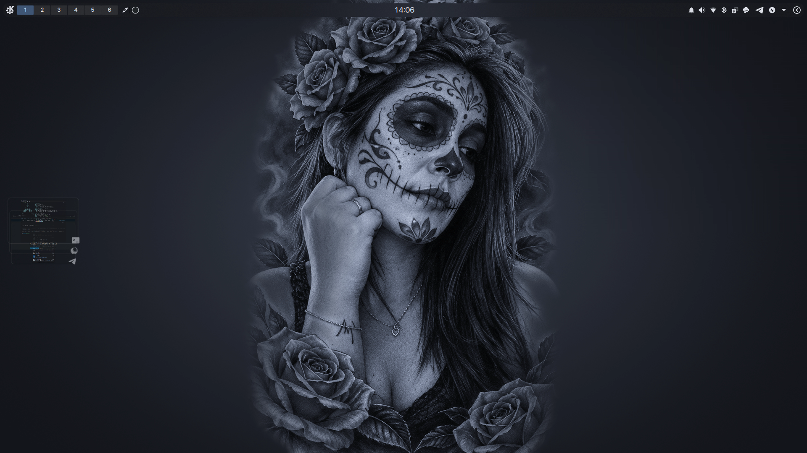
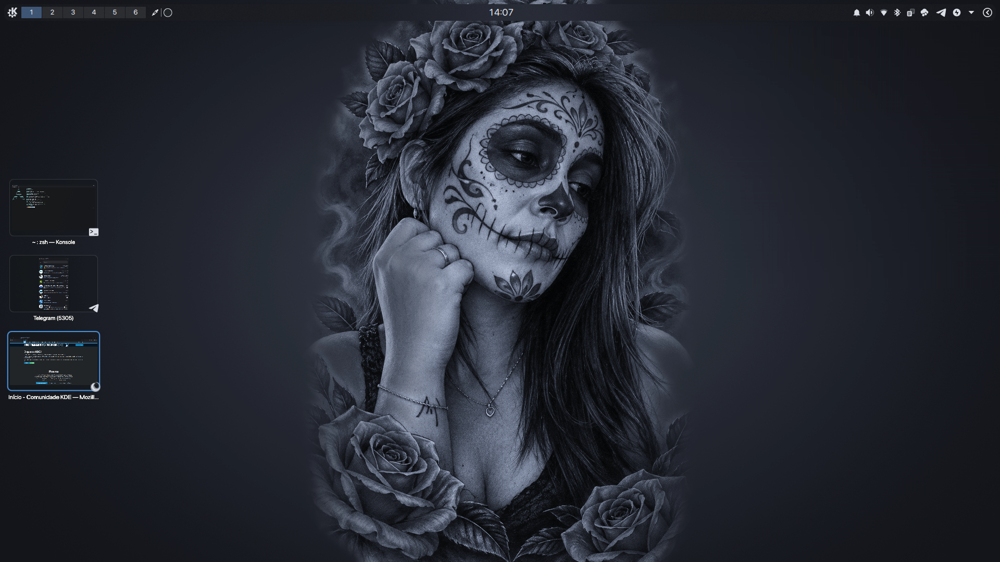
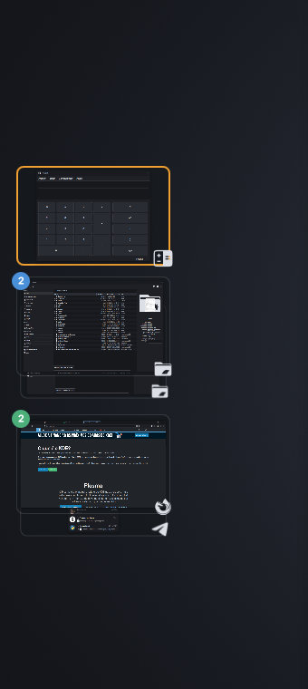

# Palco

Script do KWin (Plasma 6, Wayland) no estilo Stage Manager: as janelas minimizadas
da área de trabalho atual viram miniaturas ao vivo empilhadas na borda esquerda.
A ideia é aposentar o gerenciador de tarefas do painel: troca de janela pelo
Alt+Tab, e o que está minimizado fica à vista no palco.



## O que faz

- **Coluna na lateral**, sem fundo e translúcida em repouso: um item por grupo, e os
  grupos aparecem como um monte de cartas. Mouse em cima abre o leque com todas as janelas.
- **Clique** restaura e foca a janela. **Botão do meio** fecha.
- **Recolhe sozinho** quando alguma janela cobre a faixa; a borda fica vazia e
  encostar o mouse nela abre o palco de novo.
- **Pedido de atenção**: a miniatura sobe para o topo, ganha borda laranja e treme.
  Se o palco estiver recolhido, ele aparece por 4 s e depois fica só uma alça
  laranja piscando até você abrir a janela.
- **Sites também avisam**: quando o contador `(n)` no título de uma janela
  minimizada aumenta (WhatsApp Web, Gmail, Discord...), conta como pedido de atenção.
- **Some com o menu em tela cheia** (painel de aplicativos do Plasma) aberto.
- **Agrupa por app**: na pilha, as janelas do mesmo app viram um cartão só, com um
  selo com a quantidade; no leque aparecem todas, e o clique traz o app inteiro.
- **Modo palco** (opcional): ativar uma janela manda as outras da área atual para
  a pilha, como no Stage Manager. Janelas do mesmo app ficam juntas em cena;
  diálogos e janelas "sempre acima" (picture-in-picture) ficam de fora.
- **Cenas montadas na mão**: Shift+clique num cartão, ou arrastá-lo para fora do
  palco, junta aquele app à cena atual (navegador + terminal, por exemplo). A cena
  vai e volta da pilha inteira, num monte com selo verde. Minimizar uma janela na
  mão tira ela da cena. As cenas ficam só em memória e somem ao sair da sessão.




## Instalar

```sh
git clone https://github.com/wopgan/palco
cd palco
kpackagetool6 --type=KWin/Script -i package
```

Ative em **Configurações do sistema → Gerenciamento de janelas → Scripts do KWin**,
ou pelo terminal:

```sh
kwriteconfig6 --file kwinrc --group Plugins --key org.sylvio.palcoEnabled true
qdbus6 org.kde.KWin /KWin reconfigure
```

Para ligar o modo palco (vale após sair/entrar na sessão):

```sh
kwriteconfig6 --file kwinrc --group Script-org.sylvio.palco --key ModoPalco true
```

### Animação (opcional)

Efeito do KWin à parte, em `efeito/` (baseado no Squash): ao minimizar, a janela voa
para a coluna do Palco; ao clicar num cartão, sai dele e volta ao lugar. Cenas vão
em cascata. Substitui o Squash/Lâmpada mágica (mesma categoria "minimizar").

```sh
kpackagetool6 --type=KWin/Effect -i efeito
kwriteconfig6 --file kwinrc --group Plugins --key palco_animacaoEnabled true
qdbus6 org.kde.KWin /Effects org.kde.kwin.Effects.loadEffect palco_animacao
```

Efeito em JS não tem o cache do QML: depois de `-u`, basta `unloadEffect` + `loadEffect`.

Para atualizar: `kpackagetool6 --type=KWin/Script -u package` e saia/entre na sessão.

Os ajustes (tamanho das cartas, transparência, tempo da espiada, cores) ficam no
topo de `package/contents/ui/main.qml`.

## Limitações

- Testado no Plasma 6 / KWin 6.8 com Wayland.
- O "mouse em cima" vem da posição do cursor no KWin, e não do hover do Qt: com o
  hover, o KWin 6.8 (Qt 6.12) caía em `QQuickItem::mapFromScene`.
- Um monitor por vez: mostra as minimizadas do monitor ativo.
- Sites só avisam se a aba com o contador for a aba ativa da janela minimizada.
  O WhatsApp Web conta conversas não lidas, não mensagens: uma segunda mensagem
  de uma conversa que já estava não lida não muda o título.

## Desenvolvimento

O KWin guarda o QML em cache pelo caminho do arquivo: reinstalar e reconfigurar não
pega a mudança até reiniciar a sessão. `./dev.sh package palcodev` carrega uma cópia
de um caminho novo a cada vez (nem sempre funciona; na dúvida, instale e relogue).

## Licença

GPL-3.0-or-later. Veja [LICENSE](LICENSE).
